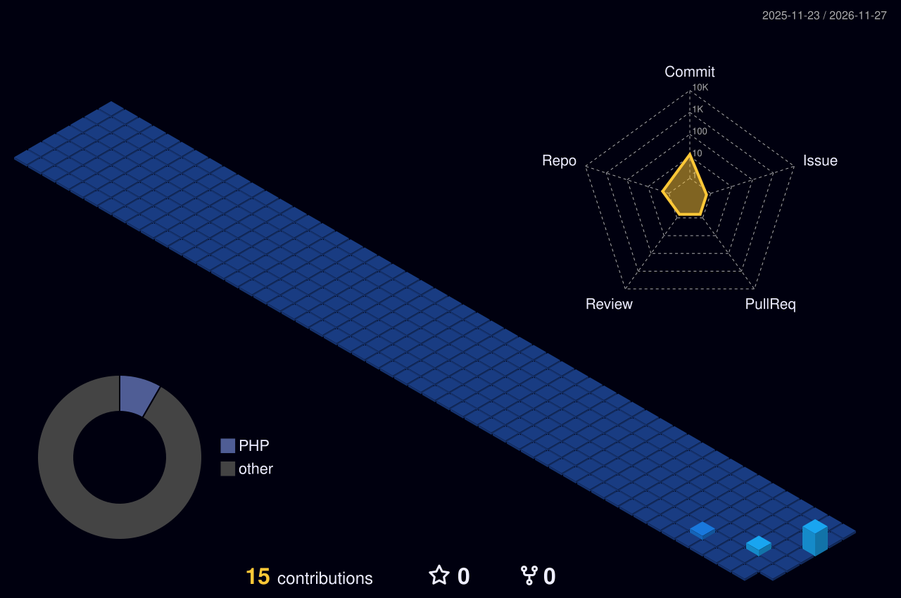

 

 

   

  
👩‍💻 Sobre mim
🎓 Estudante do Ensino Médio Técnico em Desenvolvimento de Sistemas
🏫 Estagiária no DTIE da Secretaria Municipal de Educação de Fazenda Rio Grande
📚 Desenvolvi a Biblioteca Digital SME-FRG, sistema web em uso pelos professores da rede
🎮 Crio jogos digitais educativos para as escolas municipais
🌱 Aprendendo cada dia mais sobre Java, Spring Boot e PHP
💬 Pode falar comigo sobre tecnologia na educação, web e jogos
⚡ Curiosidade: gosto de entender como as coisas funcionam por dentro
🛠️ Tecnologias e ferramentas

      

🚀 Projeto em destaque

📚 Biblioteca Digital SME-FRG
Sistema web de biblioteca digital para os professores da rede municipal de Fazenda Rio Grande, hoje em uso no servidor da prefeitura. Criei o protótipo em Python e migrei o backend para PHP para atender ao servidor institucional.
Mostrar imagem Mostrar imagem Mostrar imagem Mostrar imagem Mostrar imagem

📊 Estatísticas

    

🟦 Contribuições em 3D

  

👾 Pac-Man das contribuições

 <picture> <source media="(prefers-color-scheme: dark)" srcset="https://raw.githubusercontent.com/kelryvictoria0609-spec/kelryvictoria0609-spec/output/pacman-contribution-graph-dark.svg"> <source media="(prefers-color-scheme: light)" srcset="https://raw.githubusercontent.com/kelryvictoria0609-spec/kelryvictoria0609-spec/output/pacman-contribution-graph.svg">  </picture> 
 
